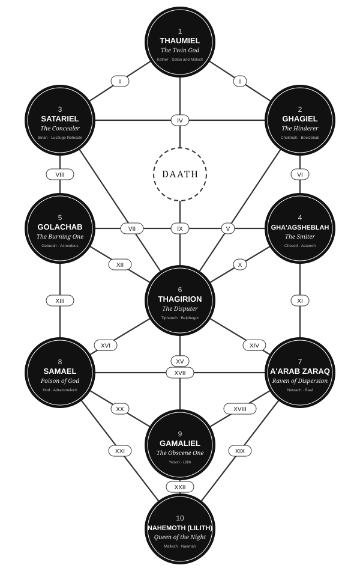

# How the Qliphoth Manipulates the Masses

**Occult Mind Control Explained**

Speaker: Luke, Sephirah Centre of Shamanism  
Source: YouTube, Sephirah Shamanism channel, published 29 July 2025  
https://youtu.be/Gg50u-CDqpA

*Corrected transcript. Auto-generated captions have been corrected for sphere names, demon names, Gnostic and Qabalistic terms and misheard words. The speaker's wording and spoken style are otherwise kept. Timestamps mark the start of each paragraph.*

---

## Chapter 1: Introduction and services

**[0:00]** Welcome all to the Sephirah Centre of Shamanism, where we break down the ancient esoteric practices of shamanism and the occult, bringing them into balance with the deep psyche. My name is Luke, experienced practitioner and mentor of the shamanic and occult sciences. As always, it's an honour to have you here with me. Definitely check out the links if you have interest in working with me. There are three links within the description of this video: the first link for my premium membership service, the second link for my Patreon, and the third link for my one-on-one healing mentoring services. Definitely check those out. I look forward to seeing you over there.

## Chapter 2: Qliphothic manipulation

**[0:37]** Today we are going to be discussing the concept of Qliphothic manipulation. Specifically, how Qliphothic technology has control over the masses and how it influences people's behavioural patterns and behaviours. The Qliphoth is a powerful dark occult technology. Dark occult technology that represents your nervous system, basically the hidden aspects of your nervous system. Every region of the Qliphothic tree represents a different portion of your body and a different portion of your unconscious mind.

**[1:15]** How the majority of us have been programmed is to avoid the unconscious mind. Avoid darkness at all costs and basically stick to a concept of false light. Stick to a paradigm of basically avoiding darkness as a whole. We have been greatly deceived in terms of which forces within the cosmos and outside of the cosmos are safe versus not safe. The majority of the collective have been wired to separate themselves from the very forces that are responsible for their self-evolution, and in doing so separate themselves from their ability to liberate themselves.

**[1:58]** And that's exactly what the Qliphothic path allows one to do. It allows one to embark on a journey of breaking free of the karmic cycles that their soul has potentially been perpetuating for many, many different lifetimes, as well as breaking patterns and programs of ancestral-level trauma and programming, as well as actually sort of decoding yourself from the preconstructed multiverse. Basically, the Qliphothic path is for becoming a leader. And what you're doing when you're choosing to enter the dark aspect of your nervous system, which is basically your internal hell structure, is that you're making a commitment to your soul. A commitment to your soul that is saying, "I am ready to decode myself from everything that I have been taught, every way in which society has wired me, so that I can actually find my own way."

**[2:57]** We are fed the illusion of sovereignty within our society. Many people think that they are choosing their reality. But when you embark on a journey like the Qliphoth, it really shows you that in many cases that is not actually the case. We are wired to think that we do have collective-level freedom and that we are able to choose our reality. But many of us are only operating from preconstructed roles and preconstructed personas and identity structures, which is basically who we define ourselves as. We are operating from certain structures that have been given to us, not that we have actually chosen. And a lot of these identity structures and personas have been given to us through trauma. Okay? And a lot of the trauma that we've experienced has basically impacted the type of personas that we have created and established.

**[3:56]** When you go into the Qliphothic tree from an initiatory standpoint, you are making a commitment to break these preconstructed personas and actually find who you are underneath it. But if you do not go into the Qliphothic initiation and you avoid your shadow and you avoid accountability and you avoid this type of energy, then what can happen is that the Qliphothic tree can actually work against you. Okay? And basically the aspects of your unconscious mind, the personifications of your unconscious mind and your repressed traumas, desires and impulses, then have a power over you from the unconscious mind, and then basically influence how you think, feel, act and respond to certain triggers.

**[4:46]** So basically I'm not saying that, you know, those who don't go into the Qliphoth are going to remain shackled for the rest of their lifetime. That's not what I'm saying. But when these personifications of your unconscious are not looked at and owned, they have control over you. They have control over your responses. They have control over how you behave in certain situations and on how you view certain aspects of life.

**[5:17]** Basically, the majority of humanity views themselves as separate. Okay? Because the false self has been established out of trauma. And in order to keep ourselves safe from the trauma that we experienced in our early years, we basically had to shell ourselves, separate ourselves from truth, authenticity, and most importantly, what the soul needs to evolve: vulnerability, and feeling and connection. So because the Qliphoth represents the shells, it's a technology of evolution. Yes. But when it is ignored and the forces within the Qliphoth are ignored, and what many people do is pretend these forces do not exist, then they have control over you from your unconscious space.

**[6:04]** Basically, what you do not look at consciously and own and integrate about yourself will function continuously as a program within your unconscious mind to keep you separated from vulnerability, in order to stick to a reality that feels safe, but in many cases is actually going to be extremely harmful to your soul. And this is the impact that the Qliphothic tree has on one's evolutionary path if they ignore it. So basically the Qliphoth is more dangerous for those who choose not to look there. Those who choose not to look in that direction, and they're looking outside of themselves and seeking according to how the patriarchal system has wired them to do. These people are being harmed by Qliphothic energies without them even realising it.

**[6:59]** And it's all in behavioural patterns and structures that are so normalised but are extremely destructive. Okay. The Qliphothic energies are wired into music videos. They're wired into advertising. And because many people have not faced these aspects of themselves and they have no plan of facing these aspects of themselves, it basically means that they are going to remain susceptible to this sort of collective-level manipulation, and it's going to work at their evolutionary detriment by causing them to gravitate towards unhealthy coping mechanisms, gravitate towards certain behavioural patterns and safety mechanisms that feel safe and basically feel good, but are actually at a severe detriment to the evolution of the soul and to the inner child.

**[7:52]** So we're going to discuss this very fascinating subject in depth. We're going to be speaking about some of the different ways in which the Qliphothic tree and the Qliphothic technologies manipulate the collective, and ultimately how we can approach these energies, whether we are initiating through the Qliphoth consciously or not. Essential subject, so definitely stay tuned.

**[8:24]** [Music]

## Chapter 3: Gnostic alchemy

**[8:48]** So as a whole, Qliphothic alchemy is something which is very linked to the concept of Gnosticism. In fact, I would call it a form of Gnostic alchemy, because it's so linked to what Gnosticism is all about. So, Gnosticism is built off of the concept of the false god. Both a literal, may I add, both a literal and symbolic concept. So, a lot of these mythologies, particularly when we're referring to the presence of spirits, they have both an internal presence, which means they represent an archetype within you, and they also have an external presence as well.

**[9:21]** I myself believe that what Gnosticism refers to as the false god, they call him Samael, they call him Yaldabaoth, Jehovah, this particular intelligence absolutely does exist. Okay? As do the archons, which are the beings that basically sow retraumatising discord and basically have the responsibility of maintaining the Qliphoth itself. When I say maintaining the Qliphoth, I mean maintaining the suppression, not maintaining the Qliphoth as an initiatory process, but maintaining its suppression.

**[10:01]** So, Gnosticism is built off of the concept that the whole reality that we live in is basically a soul-harvesting machine, that it's there to harvest the souls and sow retraumatising discord and basically keep us from evolving. Now, there is truth in that and there's also illusion in that as well. Okay, I don't want my viewers to fall into the space of, you know, basically doing what a lot of Gnostic people do, and that's blame the archons for everything, blame Yaldabaoth for everything, who's the false god, and all of these different types of things. Okay? Don't give your sovereignty away to these types of mythologies, but instead look at how it reflects to your internal process, because that's the real aim of understanding these mythologies on a different level.

**[10:52]** So, if we have the Demiurge, who is the false god in Gnosticism, then he is obviously going to be symbolic of my falsehood. Okay? And the Demiurge is said to be the cultivator of humanity. He who locked human souls within these mortal coils and basically set up a continuous process of reincarnation. Now what impacts the process of reincarnation and what life you move into is going to be the karmic cycles that your soul has developed. Okay? And a lot of these beings, these Gnostic beings, are very much symbolic of these different karmic cycles that you have within you.

**[11:28]** So basically the archons, who basically have the role of maintaining the ignorance and maintaining this so-called soul-harvesting machine that is humanity, what that basically refers to are basically expressions of your own trauma and expressions of your own karma. Okay? And you do have control over it. But the issue is that when we have been sort of misdirected and directed away from the forces of liberation, then it basically causes your free will to be somewhat spiked. Okay? Which means that we end up making decisions that aren't actually for our best interest and for our evolutionary best interest. And instead, we choose comfort over what is actually right for the evolution of our soul.

**[12:20]** This is basically how these different karmic cycles work, and therefore how the archons and the Demiurge work from a psychological perspective. Okay, basically they are there to sow separation instead of vulnerability and integration. So basically we reach numerous crossroads within our evolutionary path, numerous crossroads whereby we have the decision to become more vulnerable and open our heart, or close our heart more and then basically become more separated. And what the majority of people will do is become more separated. Okay, the soul always wants, the true self always wants integration and vulnerability, wants to open its heart and to feel safe in the world. But the false self, on the other hand, is built off of all of these different protective mechanisms and is basically going to sort of swerve your free will, because you may have learned in your past that it's not safe to be truly open and vulnerable.

**[13:20]** That in essence is how Qliphothic manipulation works. Okay? Very much tied to Gnosticism, very much tied to the concept of the Demiurge and the archons, because the Qliphoth represents the shells of falsehood, and who is the falsehood? The Demiurge and the archons. Okay. So when you don't go into your shadow at all and you don't do any self-development work at all, and particularly if you ignore the aspects of yourself that exist within the Qliphothic tree, then what many people end up doing is operating from a sort of predefined set of programs. Okay, literally like a robot, and I use the term on this channel a lot: NPC, non-playable character. One of those characters in a video game that does not do anything but respond to the programs that it's been given. Okay? And this is the majority of humanity as a whole.

**[14:09]** So basically the falsehood, the falsehood that the Qliphoth represents, and these shells that the Qliphoth represents, are basically these personas, these identity structures that have been created by you but influenced by the collective consciousness. So the Qliphoth in itself exists on the collective consciousness as well. It exists on the macrocosm and it also exists on the microcosm. Okay. And obviously the macrocosm, the collective, is going to impact the microcosm. Okay. So societal-level structures and programs are going to basically directly influence how your false self develops, and certain things that are seen as safe versus not safe. And a lot of that is also going to happen on the individual level, through the trauma that you experience.

**[15:03]** So the false self is basically there to maintain you where you are. Okay? It's there to keep you within, in a sense, a false sense of safety, and a false sense of, in a lot of ways, a false sense of evolution. Okay. An example, if we use Gnosticism again, an example would be religion. Not disrespecting anybody who is religious. Everybody's on their own path. But religion is a misdirection, you know, that programs one to fear anything that is outside of the constraints of false light. When in reality, these forces are our own unconscious mind that we all have within us. And what's within our unconscious mind is our true potential.

**[15:45]** So basically, the false self is there to hold on to false ideas of order, false ideas of light. And therefore, if we do not look at what is in the Qliphothic tree at all, then those impulses leak through. Okay, they leak through. It kind of bleeds through into the conscious mind and brings you certain experiences that are there specifically to flesh out your initiatory process, to return you to your truth and authenticity. Now some people would call this the shadow. Okay, the fact that your unconscious mind magnetises your experience. The Gnostics would call it the spark, the divine spark of Sophia. The Satanic community would call this the black flame. Basically, the spark of pure potential that is within your being, that resonates with your full potential and therefore resonates with your unconscious mind, basically pulls in experiences that are there to basically help you to break your karmic cycles, and in a sense restructure your false self to be a more solid and sustainable vehicle for your evolution.

**[17:02]** But how we've been programmed is to avoid chaos. So when chaos actually unfolds in an attempt to actually get us out of a state of suppression, then we are responding to predefined programs and safety mechanisms that are there to basically villainise the chaos and run in the opposite direction and cope with it. Okay. Everything with the false self is all about coping. Okay. The therapeutic community is all about coping. The new age spiritual community is all about coping. Our entire world is built off of the idea of coping with emotion instead of actually looking at it. Okay? And that is how the false self functions. It's "how can I cope?" Okay? How can I cope? Not how can I grow, not how can I evolve, not how can I use this experience to actually help me evolve, but how can I cope? How can I maintain my false sense of security?

**[17:58]** And this is basically the impact of the Qliphoth when it is not looked at or integrated. Okay. The Qliphoth controls you, controls the masses, from the unconscious space. Okay. And you end up falling a victim, like what many people do. Falling a victim to chaotic circumstance, falling a victim to what happens outside of you, because the false self has basically created this notion that you are not a sovereign being, and society around you is cultivated in a specific way that is basically to distract you from your own sovereignty.

## Chapter 4: Supernal triad

**[18:41]** So different stages of the Qliphothic process, different regions of the Qliphoth, hold different levels of control over the masses. Okay? And different levels of control over you. So I've never explained it in this way before. It's going to be very interesting. Okay. So I'm going to show the Qliphoth here, and I'm not going to explain the initiatory process, because the initiatory process is basically the process of breaking out of these different personas and layers of your false self that are keeping you shackled. But I'm going to explain it in the opposite direction, from the top of the tree down, and actually show you how these structures have been maintained, or should I say how these structures have been cultivated and how they are maintained on the individual and collective levels.

**[19:22]** Okay. So much like the Sephiroth, which is the Tree of Life, the divine essence streams down from the top sphere and then enters into the earth sphere. Okay. But with the Qliphoth it works the same, but from a more sort of imprisoning perspective. Okay. So with the Qliphoth, instead of the divine essence flowing down and emanating through the earth, it's basically layers of entrapment. Okay, layers, different prisons that are established within the collective and within one's individual consciousness, that then impact the energy that flows down into the conscious mind and into that bottom sphere, which is the earth sphere. Okay. So, I'm going to explain how these different spheres impact the collective consciousness from the perspective of how they actually influence and manipulate.

**[20:18]** Okay. So it all starts at the top sphere, which is Thaumiel. And Thaumiel is the twin gods, and ruling over this are two personifications of adversary. Okay, two forces that oppose each other, that battle for the throne. Okay, battle for control. One of which is Satan. He is the alternating current, and the direct current is Moloch. Okay. And these beings are basically personifications of the masses. Okay. The masses as a whole. And what Thaumiel does from a suppression point of view is that it's that lowest point of separation. It's that lowest point in the unconscious mind, in terms of a tangible region anyway, that starts to bring an illusion as to how creation actually came to be.

**[21:08]** So from a suppression point of view, Thaumiel weaves the illusion that creation has come from a different place to what it actually has. When you initiate through Thaumiel, you gain gnosis into how creation actually came to be. So that means that the shell of Thaumiel represents the lie of creation. Okay, the lie of creation. And this very easily, well, could very easily be interpreted as "God created everything" in terms of Gnosticism: Yaldabaoth, the false god, created everything. So Thaumiel has the majority of control, purely because this is basically how creation came into being, or should I say the lie of creation itself, the lie of how creation actually came to be, that exists within Thaumiel. And that in itself is an extremely powerful sphere that then causes a ripple through the different aspects of the tree.

**[22:16]** So those who do not realise how the Qabalistic spheres work, they're a bit like those dolls that fit inside each other. Okay? And Thaumiel is somewhat the biggest doll that is basically fitting all of the other Qliphoth inside it. So this is where the first point of suppression comes, and the first lie is told about how we have actually come to be, that exists within Thaumiel. This is the true gnosis that exists within Thaumiel. But if you don't initiate through the sphere, then it remains concealed from you, and you remain operating from a place of complete illusion as to where you've actually come from in the first place. Extremely dark, but that is the first layer of repression that takes place. Okay, from a religious perspective this is the lie that one God created everything. Okay, that is Thaumiel.

**[23:11]** Okay, and it's said, I don't read too much into the elite, but it's said that the elites work a lot with Moloch, okay, the direct current, and, you know, the energies of Thaumiel, to actually weave, you know, direct control over the masses. Okay, the Freemasons and certain lodges within the Freemasons are also linked to have symbolism, actually have resonant symbolism, with Thaumiel itself. And Thaumiel's sort of logo, if you will, or, you know, how Thaumiel often appears, is like two eagle heads, you know, so almost like emerging from opposite spaces, referring to the opposing forces of creation. Then, you know, this particular logo and this symbolism is used within a lot of secret societies. So Thaumiel in itself, I feel, is used within a lot of these societies that do have a vast level of control over the masses. But again, we don't want to place too much of our sovereignty into this type of belief system.

**[24:13]** So Thaumiel is where that repression of creation and one's true divinity comes from. This is basically where your divinity is held and how it is repressed from you. Okay. So the lies of Thaumiel, when you don't initiate into it, the impact that it has is that you are not a god. The impact that it has is that you are not divinity, and we need to place that sovereignty into forces that seem to far surpass our level of intelligence. It's a dark, dark, distorted lie, but impacts all of us unless we consciously choose to do something about it.

**[24:57]** The repression then moves further once divinity has been repressed within Thaumiel. It then radiates itself outwards, down to Ghagiel. Okay? And Ghagiel is the divine masculine. Okay? This is ruled by Beelzebub, who is a personification of the wounded masculine. This is where the real control starts to be woven in. Okay. Beelzebub represents the power struggle of the divine masculine, and Ghagiel, which means "hinderers", is basically representative of the totalitarian gnosis and all aspects of humanity that basically operate from castrated masculinity.

**[25:42]** And castrated masculinity happens, all you have to look at is the mythology about how Eve is blamed for everything and the feminine is blamed for everything. When the masculine is taken away from the feminine, or should I say the feminine taken away from the masculine, that castrates the masculine and then creates the wounded masculine. Okay. And the wounded masculine is all things relating to Ghagiel, which is domination, control, power, cult-like energy. Okay. The cultivation of followers, the manipulation of the masses, all of this exists within Ghagiel. Okay. And the gnosis within Ghagiel is basically how to break out of these different impulses within you. But obviously, if you remain separate from that particular realm and you don't actually go into it consciously, then the control will kind of leak through. The power struggle will leak through you and it will continue to play out unconsciously without you actually realising it.

**[26:42]** Okay. So, Ghagiel holds that aspect of wounded masculinity that controls our world. Okay. And the Supernal triad are basically the foundations. Okay. These are the foundations. These are, you know, literally the inverted divinity that controls our world. Okay. Thaumiel removing our divinity, and Ghagiel actually, you know, is what happens when our divinity is removed. When our sovereignty is removed, it leaves us within a consistent space of power struggle within ourselves, as a result of the societal-level programming and our trauma fragmentation, our individual trauma fragmentation, which basically makes us susceptible to the influence of society.

**[27:31]** Okay. It makes us susceptible to the influence of society, as to like, "Here, go and have this beautiful McDonald's burger that's going to basically destroy your liver. Here, like, go and drink this beautiful alcohol. Yeah. Oh, here, watch this music video," and actually get, you know, this sort of programming implanted within you. Okay. When our divinity and sovereignty is taken away through Thaumiel, it makes us susceptible, because basically we have been taught that we have no power, and we've been taught that we don't have true access to power and the power exists outside. So then that's when Ghagiel takes that energy and then manipulates it, and this is where the control comes in. Okay? Deep, deep energy. Okay? And you initiate through Ghagiel, you gain gnosis of that. It's crazy.

## Chapter 5: Satariel and Gha'agsheblah

**[28:23]** So once the control has been established through the wounded masculine sphere of Ghagiel, the essence then moves through into the inverted feminine, which is Satariel. And this is where truth is concealed. Okay. Satariel, ruled by Lucifuge Rofocale, name means "he who flees from light". Satariel is the concealers. It's basically a big labyrinth of veils that has been cultivated both by yourself and by the collective. So this is where truth is concealed from you. If you initiate through Satariel, you go through trials of spiritual fog and crisis, because you don't know what's real and what's not. No exaggeration, but all it's doing is showing you how confused you have been without actually realising it. It's showing you how veiled your reality has been without you actually consciously realising.

**[29:13]** So when the control over the masses has been gained from the essence of Ghagiel, the essence moves across, and then this is where the lies develop. Okay, this is where the lies as to how things actually are, as to what power actually is, is developed. Okay, this is where, you know, on the individual level, this is where we conceal ourselves in all kinds of protective mechanisms to basically keep us safe from the truth. And the truth is our power. And what is more scary to embody than true authentic power and freedom, when all you've known is being shackled to these particular veils? Okay? And that is what Satariel does.

**[30:03]** It's a concealing energy. It conceals truth from you. Which means that when you initiate through it, you go through a process of finding what that truth is and shedding the veils. But if you don't initiate through it, then the truth, your true gnosis, your true will, gets concealed from you, hidden from you. And we then have to function within those veils. Okay? And this is the thing. We end up living within a space where we lie to ourselves. Lie to ourselves completely, thinking that this is our reality, thinking that this is who we are. "This is who I am, this is how I define my sense of self, I am this mask, I am this role." That's Satariel. Okay, that is the soul's blueprint getting lost in the obligations of the external world. The soul's blueprint getting lost in the concealment of the veils within Satariel, the concealment of your true essence. And each veil is representative of an aspect of your identity that is established to keep you safe from your own soul's essence and keep you safe from your own true divinity.

**[31:06]** So the Supernal triad, from a manipulation perspective, is all things that are basically controlling our mentality. Initiating through them triggers drastic shifts in perspective as you see past all of the veils. But if you don't initiate through them and you don't look at them and you don't look at what's in it, then these foundations continue to rule you without you actually realising it. And it's very clever how the false self hides itself. Okay? Particularly when it hides in evolution and it actually classes dissociation as evolving, i.e. the majority of the spiritual community, i.e. the majority of religious groups. Okay.

**[31:52]** So the Supernal triad are the foundations in which inverted divinity is held. Starting with Thaumiel, whereby the truth about your divinity is kept away from you. The truth about your own sovereignty is kept away from you, and you're taught to believe that you don't have sovereignty or autonomy. In Ghagiel, that's when you don't have autonomy and you don't have your sovereignty, then it makes you susceptible to the influence of the masses, because the false self is just trying to keep itself safe. And then Satariel is when your true essence is concealed from you. Is when the truth is concealed from you and veiled within lots of different lies and lots of different sort of obscurations as to what reality actually is. Very, very deep.

**[32:43]** When we get to the lower spheres. Okay, I'll start by explaining Ghagiel. Okay, so Ghagiel is diagonal, across through the abyss from Satariel into, um, sorry, not Ghagiel, Gha'agsheblah. Okay, and Gha'agsheblah is the smiter, ruled by Astaroth, and this is the sphere of inverted abundance. Okay. So this is where scarcity develops. Whilst the Sephirothic aspect is Chesed, which is where love, compassion and the ever-flowing river of beauty start to be cultivated, Gha'agsheblah twists that. Okay, twists that, traps the true ever-flowing river of love, compassion and kindness, and traps it in coping mechanisms.

**[33:25]** So on the unconscious mind, this is where addictions are, in Gha'agsheblah. This is where addictions form. This is where real scarcity around abundance and self-value begins to develop. Okay? And this is influenced by a lot of programming within the media day to day, in terms of being programmed into eating terrible food, drinking loads of alcohol, getting a McDonald's multiple times a week. All things like that, in terms of Gha'agsheblah, are very much woven into the collective consciousness in order to maintain coping mechanisms. So when you go into Gha'agsheblah, you go through a series of trials that are basically temptations. Okay, you get temptations as to, you know, what happens if you relapse back into your old patterns. Okay. So basically you're basically initiated out of your addictive tendencies.

**[34:29]** So if you don't initiate through that, then it basically means that, you know, your true abundance and sense of self-value is concealed and trapped within Gha'agsheblah, and then is operating from a space of incessant hunger. Okay. And this is the pit of desire, which basically is what, you know, fuels, you know, excessive desire and hunger for things that exist outside of you. This is what I call the realm of the hungry ghost. This is the realm that influences you into chasing, chasing, chasing for your own self-worth. Chasing for things that are outside of you to fill a void, which can happen through the acquisition of knowledge. It can happen through sort of substances, alcohol. This is where that void of desire exists within you. And Gha'agsheblah holds those coping mechanisms in place. Holds those coping mechanisms in place until you are ready to break out of them.

**[35:23]** Okay? So Gha'agsheblah is where, in the collective, the manipulation around self-value happens. Okay? "Oh, you need to feel enough, so you need to go and strive for this. Oh, you need to feel enough, you need to go and strive for that." Okay. I feel advertising, and the manipulation of advertising, is greatly influenced by the unconscious trap and the pit of desire that is represented by Gha'agsheblah, because basically a lot of the sort of adverts that are promoted to the vast majority of the collective, you know, play on hunger that dwells within the person's psyche. Okay? This pit of desire that represents the void that was created from your past trauma. And a lot of these sort of collective advertisements, particularly music videos and things like that, play on this void, which then causes you to become hungry for something that is vastly outside of you. Okay. So Gha'agsheblah is that basically endless void that causes you to continuously seek yourself, your sense of self-worth, from external acquisition, be that knowledge, be it sex, be it sort of cigarettes, drugs, alcohol, whatever that may be.

**[36:48]** Okay, the essence moves across. Okay, once the pit of desire is held in place with Gha'agsheblah, we have the void that cultivates the hunger. And with the Golachab sphere, the Mars sphere, which is ruled by Asmodeus, this is the place that holds all of humanity's dark urges. Okay? Sadistic sexual urges, repressed rage, repressed everything, okay? Repressed desire for violation, repressed violence, everything like that exists within Asmodeus's sphere. And this is an aggressive sphere and has a very strong influence over the collective. Okay? Why are there so many paedophiles? Why are there so many murderers? Why are there so many rapists? Okay, we are referring to Golachab. We are referring to this realm within your unconscious mind. This very dense realm within your unconscious mind.

## Chapter 6: Golachab and Thagirion

**[37:51]** That holds these different desires and basically makes you feel that it's not okay to express them. Okay. So Golachab is an initiation that takes you into your passion, and the whole goal is to face all of these different impulses and transmute them into passion, and actually accept them for what they are, and then they don't have a power over you. But when you don't face Golachab, Golachab basically makes you feel that it's not safe to feel and embrace all of these things. So this is the programming in the collective that basically pushes repressed feelings down. Makes you feel like it's not safe to feel and embrace passion. Makes you feel gaslighted whenever you express anger, and is what plays out and leaks through in the collective all the time. It's what creates violence. It's what creates, you know, violation in the world. The violation of innocence.

**[38:39]** Okay. Our whole world is built to basically repress the inner child, and in many cases sacrifice the inner child for obligation, for obligation that we feel to function within the world around us. And this innocence is kept within Golachab. Okay. And the place within Golachab that's highly symbolic of this is the nine circles of hell, which are the different torture chambers. If you don't face them consciously, then the inner child remains encased within these different layers of hell and remains in a place where it's being continuously tortured and continuously shamed. And this is quite a scary sphere when it goes unchecked, because this is what causes people to fall into their perverted fantasies. This is what causes people to, you know, go out and rape somebody. It's what causes somebody to, you know, do horrible things, you know, because they have basically repressed their innocence so much, to the point where the innocence is completely exiled and often dead, being held within this sphere, which then causes these people to then go and seek this innocence through the external world in other ways. Okay? Playing out through their desires, playing out from their perversions and all things like that.

**[40:06]** So this is a very important adversarial sphere when it comes to, you know, initiating through it, because it is what liberates your inner child. It sets your inner child free. Sets your inner child free and helps you to embody passion. When it's not faced, then that innocence remains entrapped. The passion remains villainised, and often we lie to ourselves about that. "I'm embodying passion. I'm embodying passion." But how much passion have you learned is not safe to feel and embrace? Okay? Because Golachab holds all of this within your unconscious mind. So the control that Golachab has is basically the repression of innocence, and the repression of innocence that takes place within the collective consciousness has dire consequences, dire consequences that cause the same horrible crimes and the same horrible things to happen time and time again. And all of this is repressed within Golachab. When these impulses are not looked at and owned, they are concealed and held within the unconscious mind. Concealed and held within the unconscious mind, because our false self is like, "No, you're not allowed to feel this. Your society is not accepting of these feelings." And of course, they leak through, through uncontrollable sort of impulses and uncontrollable urges. So, it has a very intense impact, Golachab, on the collective when it isn't faced consciously.

**[41:39]** Thagirion, the place of the black sun. Now the black sun is the sun that shines only for itself. It's the opposite to the illuminating sun. It vampirises. It shines only for itself. So with Thagirion, this is what maintains a false sense of self-image. Okay. Thagirion tests you when you go into it. Tests you through illusions of grandeur. You get tested through, you know, facing illusions about yourself, certain lies that you've cultivated about how you've come further than you have, and all things like this is what you face within Thagirion.

**[42:15]** Okay. So, Thagirion is the place that basically maintains, from a suppression point of view and from a control point of view, this is what basically maintains a sort of materialism that keeps you distracted. Okay? This is what keeps you caught up in other people's view of you, from a false-self perspective. How this plays out in the collective a lot is with social media. Okay? Certain people that need to be seen in a certain way in order to, you know, maintain their falsehood, in order to maintain their sense of self-identity. All of this is held within Thagirion. Okay? And this is held within Thagirion because you're basically embodying unconsciously the essence of the black sun, which is basically trying to hold on to these different illusions of grandeur within your day-to-day life. Hold on to this sort of, you know, this sort of false idea as to who you think you are. Holding on to pretence.

**[43:09]** Okay, a theme within Thagirion is the maintenance of pretence. Okay, that keeping up of appearances, you know, having to, you know, maintain yourself in a certain way in order to feel enough for the world. This is the core thing that represses a lot of people's power. And this is in the power centre. This is the centre of the tree, which is the solar plexus. Which means that, you know, Thagirion, when it's not faced, it inverts your trust in yourself, and it inverts your own sort of capability and your own power. So instead of embodying that true authentic power, you end up getting caught in illusions as to who you think you are, as well as different layers of pretence, and basically the extremely tiresome maintenance of an identity that you learned from your early years that you have to maintain, otherwise you are not enough.

**[44:14]** Very, very dense. You see this playing out on social media, the whole people-pleaser energy. "I need to please other people in order to feel enough." That's a black sun quality. Yeah. The black sun quality. That is a black sun quality of vampirising other people in order to maintain your own illusion. And this is how Thagirion plays out within the collective: vampirising the external world to maintain your own illusion of grandeur. Very, very dense.

**[44:40]** So once Thagirion has basically established and encased this illusion of grandeur and illusion of pretence, this is then carried further by A'arab Zaraq, ruled by Baal. Okay? And bear in mind that these demonic forces have the role of liberating you. But from a manipulation point of view, A'arab Zaraq is basically where the real fruits of the ego are established. This is more direct coping mechanisms and things that you're using to invert your own beauty. A'arab Zaraq is the inversion of victory and the inversion of beauty. So from an initiatory perspective, Baal has the role of returning you to your leadership, which means that from a manipulation standpoint, when you don't look at A'arab Zaraq and you don't look at what's in it, this holds your inversion of beauty.

**[45:40]** How you can see this playing out within the collective is seeing something in the collective that represents something that you feel you don't have within yourself. You might look at a spiritual teacher and think they have something that I don't. You might look at somebody on social media and think that they look happy, without actually realising anything about their journey. Okay, it's just the persona that's being emanated. So in a sense that cultivates the persona, cultivates the illusion, and A'arab Zaraq is what basically reacts to that illusion and basically builds certain structures in order to then keep yourself safe, or keep yourself safe from true beauty. Because through a lot of our trauma, we've learned that true beauty and true and authentic victory is not safe to feel and embody.

**[46:31]** So within A'arab Zaraq, the manipulation that takes place is basically anything that takes you away from your true authentic beauty. Anything that takes you away from victory. Okay, this comes through in the collective by, "Okay, you achieved something, that's great, but now you've got to deal with this. Now you've got to deal with that. Now you've got to deal with this." Coping mechanisms from the perspective of anything that you're using to invert your own true essence. Okay? If you are, say, looking on, say, social media or at somebody else and you're wanting to have their beauty, and you don't feel as beautiful as them, or, you know, you're looking at a certain teacher and wanting to embody what they are emanating. Okay. And this is a very masculine energy. It's an inverted masculine energy. It's directly below Gha'agsheblah, purely because it holds this illusion, this illusionary construct as to what beauty actually is and as to what victory actually means.

**[47:39]** So this causes people to become more stuck in illusionary desires, to become more stuck within aspects of themselves that aren't fully present with their reality. And basically causes that wounded masculine energy to sort of operate at an extremely extensive rate, that basically causes people to not be able to sit with who they are now, but constantly strive towards who they think that they need to be in order to feel enough in the world. Okay? And Baal is the liberator here. Baal is the liberator by showing you what real leadership actually is, and by initiating you beyond that, by helping you to face these different coping mechanisms. But when they're not faced, it causes people to continue to strive for false aspects of themselves that they think, you know, define who they are as a person.

**[48:33]** Okay, "I'm who I am, you know, because of this output." Okay, this is the collective wound of A'arab Zaraq that it sows into the collective, of very much being like, "This is who I am and I'm defined by my output. I'm defined by how much work I do. I'm defined by, you know, how many pictures I post of myself online. I'm defined by all of these external things that represent masks, because I'm scared of how people would really see me if they saw who I was beyond these masks." Okay. The wound of A'arab Zaraq goes extremely deep, cuts extremely deep.

**[49:07]** And this is very much this whole sort of right pillar here. The right pillar, the masculine pillar, the inverted masculine pillar, is what holds up that sort of the illusion of masculinity as a whole. Starts at the top with Ghagiel, with control over the masses. When the sovereignty is taken away, you know, fear is developed, powerlessness is developed, and then people are more impressionable and more controllable or, you know, able to be controlled. And then Gha'agsheblah creates the pit of desire. Okay, that incessant hunger and, you know, need to fill a void that never actually gets filled. And then A'arab Zaraq seals both of those energies. So with this whole pillar, this masculine pillar, you are influenced by, you know, control that's exhibited by Ghagiel, the desire that's cultivated by Gha'agsheblah, and the striving for illusionary desires and illusionary attainments that is cultivated by A'arab Zaraq. Okay. So this whole pillar inverts masculinity as a whole.

*[Editorial note: from 50:21 to 54:52 the video repeats the A'arab Zaraq passage of 44:40 to 49:07 almost word for word, most likely an editing error in the upload. It is kept here for fidelity. The second copy omits the right-pillar summary and leads straight into Samael. Nothing new is said.]*

**[50:21]** So once Thagirion has basically established and encased this illusion of grandeur and illusion of pretence, this is then carried further by A'arab Zaraq, ruled by Baal. Okay? And bear in mind that these demonic forces have the role of liberating you. But from a manipulation point of view, A'arab Zaraq is basically where the real fruits of the ego are established. This is more direct coping mechanisms and things that you're using to invert your own beauty. A'arab Zaraq is the inversion of victory and the inversion of beauty. So from an initiatory perspective, Baal has the role of returning you to your leadership, which means that from a manipulation standpoint, when you don't look at A'arab Zaraq and you don't look at what's in it, this holds your inversion of beauty.

**[51:15]** How you can see this playing out within the collective is seeing something in the collective that represents something that you feel you don't have within yourself. You might look at a spiritual teacher and think they have something that I don't. You might look at somebody on social media and think that they look happy, without actually realising anything about their journey. Okay, it's just the persona that's being emanated. So in a sense that cultivates the persona, cultivates the illusion, and A'arab Zaraq is what basically reacts to that illusion and basically builds certain structures in order to then keep yourself safe, or keep yourself safe from true beauty. Because through a lot of our trauma, we've learned that true beauty and true and authentic victory is not safe to feel and embody.

**[52:11]** So within A'arab Zaraq, the manipulation that takes place is basically anything that takes you away from your true authentic beauty. Anything that takes you away from victory. Okay, this comes through in the collective by, "Okay, you achieved something, that's great, but now you've got to deal with this. Now you've got to deal with that. Now you've got to deal with this." Coping mechanisms from the perspective of anything that you're using to invert your own true essence. Okay? If you are, say, looking on, say, social media or at somebody else and you're wanting to have their beauty, and you don't feel as beautiful as them, or, you know, you're looking at a certain teacher and wanting to embody what they are emanating. Okay. And this is a very masculine energy. It's an inverted masculine energy. It's directly below Gha'agsheblah, purely because it holds this illusion, this illusionary construct as to what beauty actually is and as to what victory actually means.

**[53:15]** So this causes people to become more stuck in illusionary desires, to become more stuck within aspects of themselves that aren't fully present with their reality. And basically causes that wounded masculine energy to sort of operate at an extremely extensive rate, that basically causes people to not be able to sit with who they are now, but constantly strive towards who they think that they need to be in order to feel enough in the world. Okay? And Baal is the liberator here. Baal is the liberator by showing you what real leadership actually is, and by initiating you beyond that, by helping you to face these different coping mechanisms. But when they're not faced, it causes people to continue to strive for false aspects of themselves that they think, you know, define who they are as a person.

**[54:06]** Okay, "I'm who I am, you know, because of this output." Okay, this is the collective wound of A'arab Zaraq that it sows into the collective, of very much being like, "This is who I am and I'm defined by my output. I'm defined by how much work I do. I'm defined by, you know, how many pictures I post of myself online. I'm defined by all of these external things that represent masks, because I'm scared of how people would really see me if they saw who I was beyond these masks." Okay. The wound of A'arab Zaraq goes extremely deep, cuts extremely deep. And this is very much this whole sort of right pillar here, the right pillar, the masculine pillar, the inverted masculine pillar.

**[54:52]** So we move on to Samael. Okay. A'arab Zaraq establishes the fruits of the ego. The illusions of what to strive for. The illusions of victory. The illusions of beauty. The coping mechanisms that keep you separated, that keep you running on an illusionary treadmill, thinking that you are fulfilling your true essence.

## Chapter 7: Lower spheres

**[55:17]** Samael, on the other hand, solidifies the prison. Samael is the poison of God, and this is the place of the Demiurge. Okay, this is where the illusion is solidified into your consciousness, into your nervous system. This is where the real repression takes place. Okay, the essence flows: once the illusionary desires of victory and beauty are established within A'arab Zaraq, then Samael encases them further, and this is where reality becomes a prison. Okay, this is where we embody an ego that cannot see anything past itself.

**[55:54]** Okay, when you initiate through Samael, you are basically sort of receiving trials of insanity. It feels like you're losing your mind from time to time when you're going through the Samael initiation. But all that's happening is that a huge prison, holding your true sense of self, is being completely dissolved and removed. And it feels extremely uncomfortable from an initiatory standpoint, because you're dissolving, like, your entire foundation of reality. But Samael is basically where it all gets solidified into one. It's like, "This is who I am. This is me, and this is how I define my sense of self."

**[56:33]** It's also, you know, the last point on the inverted pillar of severity, which means that this is the feminine pillar, the dark feminine pillar, which means that all of these spheres, namely Satariel, the concealers, the veils of illusion; Golachab, the burning ones, that holds all of your repressed desires and perversions and rage; Samael then takes all of that and solidifies that into one identity. "This is who I am. This is who I am. I can see myself, taste myself, touch myself, and this is who I am. This is who I'm going to emanate within the world." Okay. So these spheres are much more internal and they are much more suppressing in nature.

**[57:16]** Okay. So when you initiate into them, they have the opposite effect. You, you know, are experiencing what's been repressed. But when you're not facing them, you know, Satariel brings in and conceals your truth, Golachab conceals your passion, and then Samael conceals your sense of self. Okay. And this is where you really can, you know, before initiating into Samael, you cannot see past yourself. You cannot see past your illusions. Okay? And it's a very important adversarial energy to embody, because it initiates you beyond the constraints. It initiates you beyond the constraints of your ego. And from this point, you haven't got rid of your ego, but your ego is more fluid and more willing to grow with you after Samael. Whereas before that, it's all kind of, you know, hard-coded into place. It's like a computer that's got all of these different wires sort of plugged into it. It's literally like you're plugged into, if I was to use The Matrix as an example, it's like you're plugged into the Matrix with this particular current.

**[58:29]** Okay? It's an extremely, extremely dark current of energy when you are not actually facing it at all. And this is the real safety mechanism that takes place within the system. Most people will not get past this point in any way whatsoever, let alone get to the later stages, because many people aren't even aware of what the system is, or even remotely aware of the control that it has over the masses. Okay, and this is where, you know, you don't even realise that you're controlled at all. Okay, within Samael you don't even realise that, you know, you're emanating something that is not actually you and has never actually been you. It's just been given to you out of obligation. Okay.

**[59:12]** So, we move down to the last two spheres. Okay. We move down to Gamaliel. And Gamaliel, we're moving into the lower parts of the tree. Gamaliel is Lilith's sphere. And this holds everything that is obscene. All that is obscene. Okay? Illusionary desires, sexual fantasies, you know, your real ability to navigate truth beyond the constraints of this particular shell. So this is what causes people to get stuck within sexual desires. Okay? It causes people to get, you know, stuck within lust. Basically, how this plays out is people who have not integrated their Lilithian archetype. They haven't integrated the Lilith within them. So instead, they fall a victim to the actual archetype of Lilith instead of integrating Lilith, which means that they're caught within, you know, desires. They're caught within, you know, different aspects of perversions. And the problem with this is that, because the repression's taking place from Samael, you can't even see these desires until you initiate into this sphere. Okay? You can't even see, you know, these desires, which have been so repressed and, you know, very much kept from you.

**[1:00:28]** Okay. So an example of how this would play out is, say, within the porn industry. Okay. Within the pornography industry, you know, this is very much, you know, ruled by inverted Lilithian energy. Don't get me wrong, Lilith doesn't rule it. She represents the archetype of it, that if it's not integrated, then it will continue to play out unconsciously. And this is where people basically fall victim to their sexual desires, waste their sexual energy, and very much, you know, it causes that sort of coiled serpent at the base of the spine. So the kundalini energy, the life force energy, is not able to rise up past that point, which means that, you know, it causes the inversion of sex overall. Okay. It causes a massive confusion as to what sex actually is and what intimacy actually means and what sexual alchemy actually means. Instead, it just gets trapped in all of these, you know, outer-layer desires as to what we have been taught that sexuality is within our world. Extremely dark. And this controls the world.

**[1:01:34]** Okay. Many people are controlled by their sexual urges without truly realising it. Okay? Even if it doesn't come through in the form of intimacy, in the form of, you know, an actual sex addiction, but, you know, comes through in other ways, like sacrificing your life force, sacrificing yourself, giving your power away to different, you know, forces and divinities. All of this is a manifestation of the inverted sexual energy that Gamaliel represents. So this is what controls, you know, the life force energy within the collective consciousness. Okay. This sphere is the kind of centre point for the life force energy as a whole. Okay. The life force energy, the sexual energy, that is the energy of creation. And when it remains shelled, people are completely ignorant to the real potency and power of their sexual energy, and that it is truly the energy that cultivates reality. Instead, it's held, you know, within the lower genitals of the body and within the sexual organs, and doesn't actually move past that point, and is just stuck, crystallised within that area, and the life essence cannot move through. Okay. Initiation through the obscene ones, through Gamaliel, is in facing these different desires and integrating them. And obviously, if you're shelled within it and you don't look at this, then these desires are running the show from the unconscious mind without you even realising it.

**[1:03:05]** The final sphere, okay, the earth sphere, which is Nahemoth, also called Lilith, okay, ruled by Naamah. This is where the physical level of consciousness, the physical-level suppression, takes place, okay? And because this is what represses your somatic sensations. So it's very similar, this sphere, to Gamaliel. Gamaliel is basically a more psychological version of Nahemoth, and Nahemoth is a more physical version. So this is where, from an initiatory standpoint, you unlock your ability to feel into your body sensations. It's a very somatic sphere as a whole. Before this point, if we do not initiate into Nahemoth, or we do not face the essence of ourselves that is entrapped, encased within this particular sphere, then we remain numb to our body sensations. Okay? We remain numb to the fact that there's even a problem in the first place.

**[1:04:00]** Okay? And this is where unconsciousness resides, because this is the entrance point. It's the first point of initiation. This is where you wake up the Qliphothic energy within you. It's a very important initiation, you know, from an alchemical standpoint, because this is where you actually wake up the Qliphothic energy that lives very firmly within you. So basically, you're opening that centre and you're basically sort of unlocking your somatic sensations. Whereas before you go into this energy, you are numb to the majority of your body sensations. And the majority of your body sensations are basically your psyche communicating. Your psyche communicates through your nervous system, through your body.

**[1:04:47]** And when you are encased within Nahemoth, this controls the collective by basically causing them to not even know that there's a problem in the first place. Okay? Those who have not moved beyond Nahemoth and are entrapped within Nahemoth, encased within this energy, it's sowing control over the masses in the sense of basically causing you to do anything to basically stay separate from your body sensations, okay? To stay separate from feeling your emotions, from tuning into your body. This is the sphere that causes you to run away from your body sensations, okay? And not even know how your psyche is communicating with you in any way, shape, or form.

**[1:05:33]** Okay. So, at this point, it's where the real suppression and control establishes, as the energies are all concealed. All of your different soul parts are concealed, and all of these different pieces of your inner child are concealed within the higher parts of the tree. This is where the full concealment happens. This is where often you don't even realise, you know, who you actually are anymore. This is where you don't even realise that there's a problem in the first place, and, you know, your body sensations are then entrapped within this sphere. Okay? And initiating into the sphere is very physical, because it's unlocking the nightside energy within you. It's unlocking the deepest aspects of your unconscious mind that are within you, running the show. Okay? So if you don't initiate into the sphere and you don't look at what's in it, then we remain numb to what is going on within our nervous system, and we remain numb past a certain point. Okay, it's this encasement, this entrapment within Nahemoth, causes us to, you know, not even know what's going on in our body, not even know what's, you know, being processed within the psyche, which makes it an extremely important rite of passage to go through.

## Chapter 8: Projecting reality

**[1:06:44]** So once all of this energy has been, you know, developed within the unconscious mind, within the collective consciousness, and then impacted by the individual, the microcosm, then it projects into reality. Okay, and it projects all of these inversions into reality, and then causes these inversions to manifest day to day. This is why there is so much suffering in the world, because nobody wants to look in this area. Nobody wants to look this way. Nobody wants to embrace the paradox of descent. And the paradox of descent is liberating yourself by going into yourself and understanding who you really are.

**[1:07:22]** So this is like a big projector. The Qliphoth is a huge projector, and everything that is unprocessed within the Qliphoth gets projected unconsciously into the world around you, and then it brings you retraumatising experiences until you are able to actually look past it. And the problem is that many people are not able to look past and see the bigger picture of the chaos, and they just want to avoid chaos, do everything in their power to avoid darkness, when in reality it is the key to evolution. It's where your potential is held. It's where your true power, it's where your innocence is held. And the majority of the collective don't even remotely realise, you know, what is happening. It's all predefined according to the aspects of self that are repressed within here, and then projected into the world around us, which then cultivates that control.

**[1:08:17]** So every sphere, as I've explained, has different layers of control. So let me just recap what I've spoken about. The suppression starts by suppressing divinity, in that divinity is lied about and inverted, and that separates the masses from their sovereignty. When the masses have been separated from their sovereignty, it makes them more controllable, which is then developed by Ghagiel. Okay, the wounded masculine, the inverted masculine sphere. Once the control is established through the totalitarian gnosis, then the truth gets concealed. Okay. Through the power, through the excessive power and dominance of Ghagiel, the truth gets concealed. Okay. And that is symbolic of Satariel. The veils of illusion that have been created to conceal your true will.

**[1:09:15]** The pit of desire is developed within Gha'agsheblah. Okay, the pit of desire, that endless hunger, that endless hunger for what is outside of you. This is where that endless hunger is solidified into the collective, causing the entire collective to remain hungry and constantly striving for things that are outside of self instead of looking within.

**[1:09:39]** Golachab represses everything about passion. Okay? And basically makes you feel that you cannot feel anger and the deeper, darker perversions. Golachab represses innocence and is the main reason why this violence and all of the other perverted things unfold within humanity as a whole, within the collective consciousness. It's all a result of repressed innocence and repressed desire, and that is what's held within Golachab.

**[1:10:07]** Once the passion is encased, then Thagirion cultivates an illusion as to what that actually is. Thagirion is the pretence. When Thagirion is embodied unconsciously, you fall into a place of vampirising the external world, of constantly seeking the unhealthy validation from the external world in order to then feed a false structure about who you think you are.

**[1:10:43]** Once that false structure and illusion of grandeur has been established, A'arab Zaraq creates the drive in the wrong direction. A'arab Zaraq causes a drive towards inverted victory and inverted beauty, and causes you to run on a treadmill further and further away from your true essence. This is where the coping mechanisms are really established.

**[1:11:06]** Samael is the full entrapment within an illusionary structure. The entrapment within an illusionary structure so you cannot see past it. Full ignorance.

**[1:11:18]** Gamaliel is all things relating to the sexual impulses, sexual energy, all things relating to using sexual energy as a beacon of power and to actually cultivate your reality. Gamaliel inverts this, and plays out often through the pornography industry, plays out through basically keeping humanity's sexual energy trapped in the sexual organs without actually acknowledging the true power and potential of it. And this comes with, you know, programming around the serpent and all of that that's woven into mythology.

**[1:11:58]** And Nahemoth is when you become numb to your body sensations. Nahemoth encases your body sensations, encases your ability to feel on a deep, intimate level, and entraps you within the Qliphothic realms.

**[1:12:16]** All of that then projects from your unconscious mind into the world around you, and then impacts the type of experiences that come in day to day, your behavioural responses and all of these different things. Breaking out of this process starts by asking: why do you do what you do? What actually influences your decisions day to day? Is it you? Is it genuinely you? Or is it an outdated program? A program that has been given to you, a program and mask and role that has been given to you in order to, you know, help you to feel safe within the world around you, when in reality your true power and potential is trapped underneath.

**[1:13:01]** So the Qliphoth has a massive impact in terms of manipulation, huge impact over manipulation within the collective, if it is not faced consciously. So basically the Qliphoth is often more dangerous and sort of exhibits more harm when it is ignored, denied and not looked at. So initiating through the Qliphoth is making the decision to liberate yourself from these different aspects and from these different personas that will otherwise rule your consciousness and rule your life without you even realising it.

**[1:13:41]** Very important video, very deep video, but I think that's everything I need to talk about. Definitely hit like and subscribe if this video was helpful to you, and I will see you in the next video. Thank you.

---

## Appendix: structure of the interpretation

The talk descends the Qliphothic tree from the crown to the earth sphere, in the standard order, and treats each shell as one layer of a single mechanism: divinity is denied, the resulting powerlessness is exploited, truth is veiled, hunger is installed, passion is repressed, a false self-image is maintained, false striving is set in motion, the whole is solidified into one identity, sexual energy is trapped, and finally the body is numbed so the problem is no longer felt. What is left unintegrated is then projected into the world and returns as retraumatising experience.

| Order | Sphere | Sephirothic counterpart | Pillar (as described) | Ruler named | Mechanism of control (speaker's reading) |
|---|---|---|---|---|---|
| 1 | Thaumiel, "twin gods" | Kether | Middle (Supernal) | Satan and Moloch | The lie of creation; divinity and sovereignty denied |
| 2 | Ghagiel, "hinderers" | Chokmah | Right, masculine (Supernal) | Beelzebub | Wounded masculine; totalitarian control over the powerless |
| 3 | Satariel, "concealers" | Binah | Left, feminine (Supernal) | Lucifuge Rofocale | Veils; truth and true will concealed |
| 4 | Gha'agsheblah, "smiters" | Chesed | Right, masculine | Astaroth | Pit of desire; scarcity, addiction, incessant hunger |
| 5 | Golachab, "burning ones" | Geburah | Left, feminine | Asmodeus | Repression of passion and innocence; violence leaks through |
| 6 | Thagirion, black sun | Tiphareth | Middle, solar plexus | (not named) | Pretence, illusions of grandeur, vampirising validation |
| 7 | A'arab Zaraq, "ravens of dispersion" | Netzach | Right, masculine | Baal | Inverted victory and beauty; striving, defined by output |
| 8 | Samael, "poison of God" | Hod | Left, feminine | Demiurge | Illusion solidified into one hard-coded identity |
| 9 | Gamaliel, "obscene ones" | Yesod | Middle | Lilith (archetype) | Sexual energy trapped in the organs; lust, pornography |
| 10 | Nahemoth | Malkuth | Middle, earth | Naamah | Somatic numbness; the problem is no longer felt |

Consistency notes:

- The three pillars as the speaker assigns them match the standard layout. Right pillar: Ghagiel, Gha'agsheblah, A'arab Zaraq. Left pillar of severity: Satariel, Golachab, Samael. Middle: Thaumiel, Thagirion, Gamaliel, Nahemoth.
- At 32:47 the speaker starts to say "Ghagiel" and corrects himself to Gha'agsheblah. The correction is right: the path from Satariel to Gha'agsheblah crosses the abyss diagonally.
- The recap at 1:08:17 covers all ten spheres in the same order and with the same mechanisms, so the repeated A'arab Zaraq passage at 50:21 adds nothing and does not change the argument.
- Two naming choices are the speaker's own and are kept as spoken: Gamaliel is called "Lilith's sphere", and Nahemoth is "also called Lilith" while ruled by Naamah. Samael is placed with the Demiurge rather than with Adrammelech, who is its traditional ruler.

---

## Appendix: the tree shown in the video

The diagram displayed on screen is redrawn below. It follows the Western occult form of the Qliphoth: sphere names and meanings from S. L. MacGregor Mathers and Crowley's *Liber 777*, and the 22 "tunnels" with their names from Kenneth Grant's *Nightside of Eden* (1977), which in turn takes the names from Crowley's *Liber 231*. Each tunnel is the reverse side of one of the 22 paths of the Tree of Life and carries that path's Hebrew letter. Under each sphere the figure adds its Sephirothic counterpart and the archdemon traditionally assigned to it in *Liber 777*. Where the speaker's attribution differs (Samael with the Demiurge, Thagirion unnamed), the traditional name is shown here. The video's diagram calls the tenth sphere Lilith, Queen of the Night, which is why the speaker says Nahemoth is "also called Lilith".

| Tunnel | Letter | Name (Grant) | Joins spheres |
|---|---|---|---|
| I | Aleph | Amprodias | 1 to 2 |
| II | Beth | Baratchial | 1 to 3 |
| III | Gimel | Gargophias | 1 to 6 |
| IV | Daleth | Dagdagiel | 2 to 3 |
| V | Heh | Hemethterith | 2 to 6 |
| VI | Vau | Uriens | 2 to 4 |
| VII | Zain | Zamradiel | 3 to 6 |
| VIII | Cheth | Characith | 3 to 5 |
| IX | Teth | Temphioth | 4 to 5 |
| X | Yod | Yamatu | 4 to 6 |
| XI | Kaph | Kurgasiax | 4 to 7 |
| XII | Lamed | Lafcursiax | 5 to 6 |
| XIII | Mem | Malkunofat | 5 to 8 |
| XIV | Nun | Niantiel | 6 to 7 |
| XV | Samekh | Saksaksalim | 6 to 9 |
| XVI | Ayin | A'ano'nin | 6 to 8 |
| XVII | Peh | Parfaxitas | 7 to 8 |
| XVIII | Tzaddi | Tzuflifu | 7 to 9 |
| XIX | Qoph | Qulielfi | 7 to 10 |
| XX | Resh | Raflifu | 8 to 9 |
| XXI | Shin | Shalicu | 8 to 10 |
| XXII | Tau | Thantifaxath | 9 to 10 |
## Appendix: comparison with the Jewish Kabbalistic sources

The talk uses the word Qliphoth (Hebrew *qelippot*, "shells" or "husks") and the image of an inverted tree, but the system it describes is a modern Western occult construction, three removes from the Jewish sources. The main points of contact and divergence are these.

**1. Where the shells come from.** In the *Zohar* (13th century, Castile) the demonic realm is the *Sitra Achra*, "the Other Side", a parasitic domain that feeds on holiness and surrounds it the way bark surrounds a tree or a husk surrounds a kernel. The Zohar speaks of four husks, read out of Ezekiel 1:4 (the stormy wind, the great cloud, the flashing fire, and *nogah*, the brightness), and of *nogah* as a translucent husk that touches both sides and can be redeemed. Isaac ha-Kohen of Soria, writing a generation before the Zohar, produced the *Treatise on the Left Emanation*, the first text to describe a structured counter-emanation with Samael and Lilith as its ruling couple. This is the direct ancestor of the speaker's pairing of a male and female principle at the summit and base of the tree.

**2. The ten-fold inverted tree.** A list of ten demonic counter-sephirot appears in Moses Cordovero's *Pardes Rimmonim* (1548, gate 25), drawing on earlier lists, and the Lurianic school of Safed gave the shells their fullest cosmology. For Isaac Luria, as recorded by Hayyim Vital in *Etz Hayyim*, the shells are the debris of the breaking of the vessels (*shevirat ha-kelim*): the first vessels could not hold the divine light, shattered, and their fragments fell, trapping sparks of light inside them. Here lies the real root of the speaker's language of shells, sparks and trapped potential, which he attributes to Gnosticism and to "the black flame". The Lurianic image is the closest Jewish source for his claim that the shells hold something valuable.

**3. The names.** The sphere names in the video (Thaumiel, Ghagiel, Satariel, Gha'agsheblah, Golachab, Thagirion, A'arab Zaraq, Samael, Gamaliel, Lilith) are Hebrew or pseudo-Hebrew plurals that reached English through Knorr von Rosenroth's Latin *Kabbala Denudata* (1677 to 1684), then Mathers's *Kabbalah Unveiled* (1887) and the Golden Dawn, then Crowley's *Liber 777* (1909). Some are attested in Jewish lists (Samael, Lilith, Gamaliel, the "ravens" and "burners"); others are Christian-Kabbalistic or Golden Dawn coinages. The archdemons (Moloch, Beelzebub, Lucifuge, Astaroth, Asmodeus, Belphegor, Baal, Adrammelech, Naamah) are a Golden Dawn and Crowley arrangement that mixes biblical names with figures from the European grimoire tradition. Lucifuge Rofocale, for example, comes from the 18th-century *Grand Grimoire*, not from any Jewish text. The 22 tunnels are entirely Crowley's and Grant's work.

**4. What one is supposed to do with them.** This is the sharpest divergence. In the Jewish sources the shells are to be separated from, sifted and, where possible, elevated (*birur*, *tikkun*), and direct engagement with the Other Side is prohibited. The task of the kabbalist is to raise the sparks and return them to their source, not to descend into the husks. The idea of an initiatory descent through the shells, sphere by sphere, as a path of liberation is a 20th-century development: it comes from Crowley's crossing of the Abyss, from Grant's "Nightside" working of the tunnels, and from the Left-Hand-Path orders that followed him. The speaker's version adds a further layer that has no counterpart in any of these sources: the shells as a map of the nervous system and of trauma, and the archons and Demiurge as expressions of personal karma. That is a psychological and Jungian reading, in the spirit of the "deep psyche" the channel names in its introduction.

**5. Daath and the Abyss.** The dotted sphere in the diagram is Daath, Knowledge. In classical Kabbalah it is not one of the ten sephirot but a quasi-sephirah, the place where Keter is counted or not counted, and it is not treated as a gateway to the Other Side. The Abyss as a chasm to be crossed, and Daath as the door into the Nightside, are again Crowley and Grant. The speaker's remark that Gha'agsheblah is reached "diagonally across the abyss" from Satariel depends on this modern geography.

**6. The Gnostic framing.** The Demiurge, Yaldabaoth, the archons and the spark of Sophia belong to second- and third-century Gnostic texts such as the *Apocryphon of John*, not to Kabbalah. The two traditions share the motif of light trapped in a lower world, and scholars from Gershom Scholem onward have debated whether the Kabbalistic *Sitra Achra* owes anything to Gnostic dualism. The speaker fuses them freely. Jewish Kabbalah is not dualist in that sense: the Other Side is derivative and parasitic, ultimately sustained by the divine, never an independent creator god.

In short: the vocabulary is Jewish by way of Latin and English occultists, the geometry is Golden Dawn and Crowley, the tunnels and the "Nightside" are Kenneth Grant, the Gnostic overlay is late antique, and the trauma and nervous-system reading is the speaker's own. The one genuinely Kabbalistic idea that survives intact is the Lurianic one: that the husks contain something of value that must be recovered.

*Note: this comparison was written from the standard scholarly accounts (Scholem, Tishby, Idel, Dan) and from the Grant and Crowley texts in your Drive. The NotebookLM sources could not be reached from this session; if they contain specific passages you want cited, send them and I will add them.*
